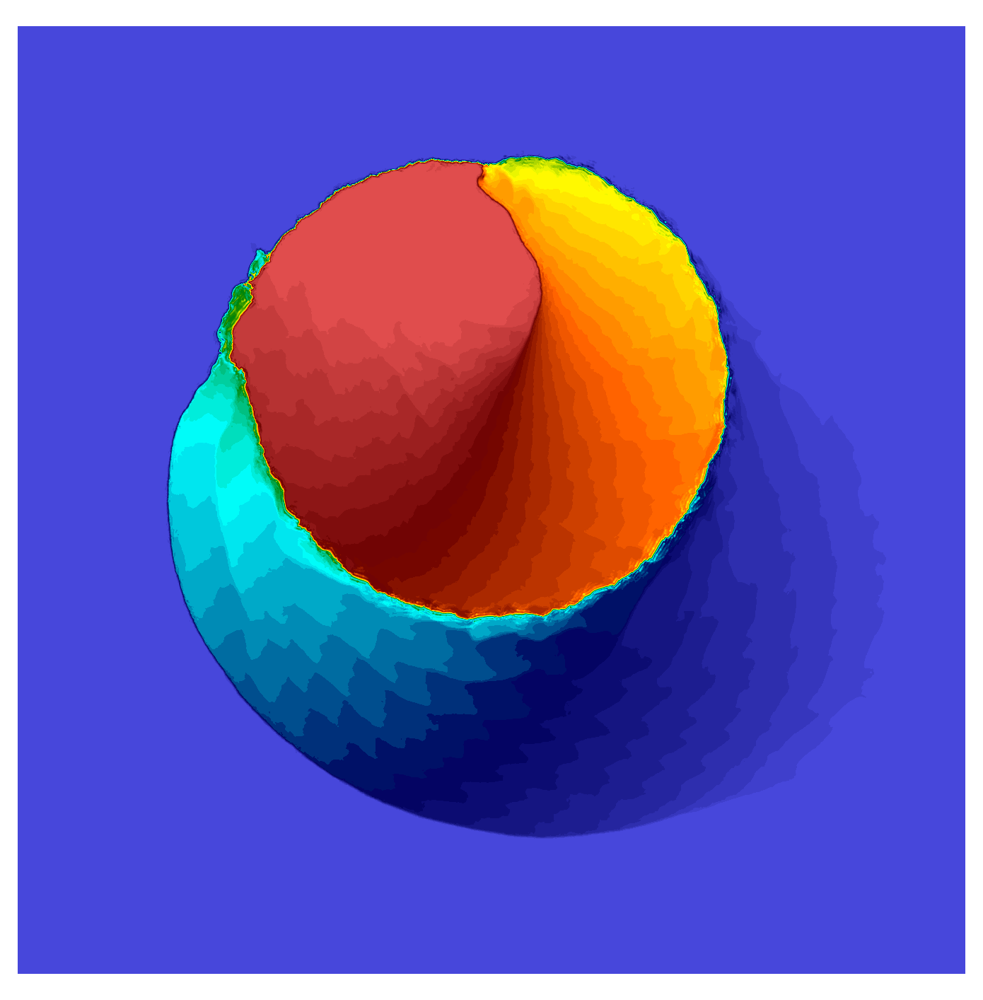
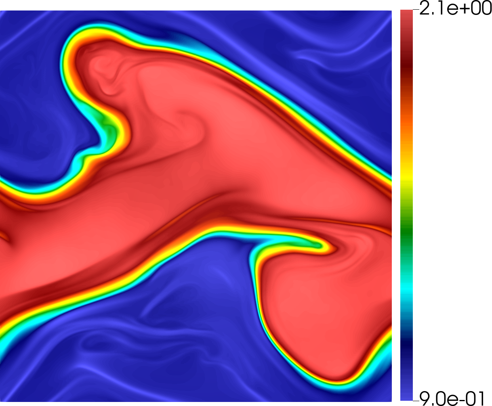
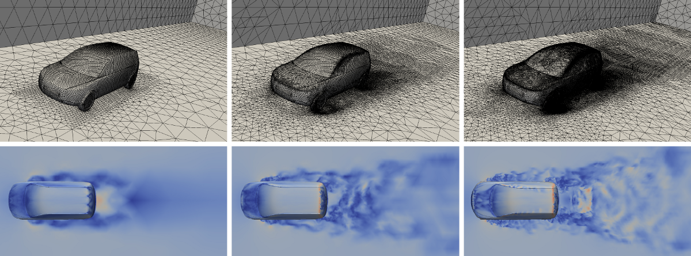

My research is in **numerical analysis and scientific computing for partial differential equations**, with applications in fluid dynamics, magnetohydrodynamics (MHD), and kinetic plasma physics.

## Structure-preserving numerical methods

<figure class="research-figure research-figure--square">
  
  <figcaption>High-order convex limiting preserves the sharp rotating-wave structure of the KPP problem.</figcaption>
</figure>

My expertise includes:

- high-order finite element and summation-by-parts (SBP) finite difference methods;
- conservation, positivity, invariant-domain preservation, entropy inequalities, and nonlinear stability;
- convex limiting, flux-corrected transport, and residual or entropy viscosity;
- nonlinear stabilization for shocks, steep gradients, and multiscale problems.

## Fluid dynamics and magnetohydrodynamics

<figure class="research-figure">
  
  <figcaption>Fine-scale structures in a high-order simulation of magnetized Kelvin–Helmholtz flow.</figcaption>
</figure>

My expertise includes:

- compressible and incompressible flow, nonlinear conservation laws, and ideal, viscous, and resistive MHD;
- high-order and continuous Galerkin discretizations;
- shock capturing and nonlinear stabilization;
- invariant-domain- and entropy-stable methods;
- reliable simulation of high-speed and under-resolved flows.

## Kinetic plasma models and fusion

<figure class="research-figure">
  
  <figcaption>Nonlinear phase-space vortex interaction in a Vlasov–Poisson simulation.</figcaption>
</figure>

My expertise includes:

- Vlasov--Poisson and Vlasov--Maxwell systems, kinetic transport, and coupled plasma-field models;
- structure-preserving and positivity-preserving discretizations;
- high-order finite element and SBP methods;
- low-rank approximations for high-dimensional phase spaces;
- matrix-free and GPU-accelerated scientific computing.

## Additional interests

<figure class="research-figure research-figure--wide">
  
  <figcaption>Adaptive meshes and evolving turbulent structures in a full-car flow simulation.</figcaption>
</figure>

My broader interests include multiscale and homogenization methods, adaptive computation, parabolic regularization, and reduced representations for high-dimensional PDEs.

For publications related to these topics, see the [Publications](/publications/) page.
